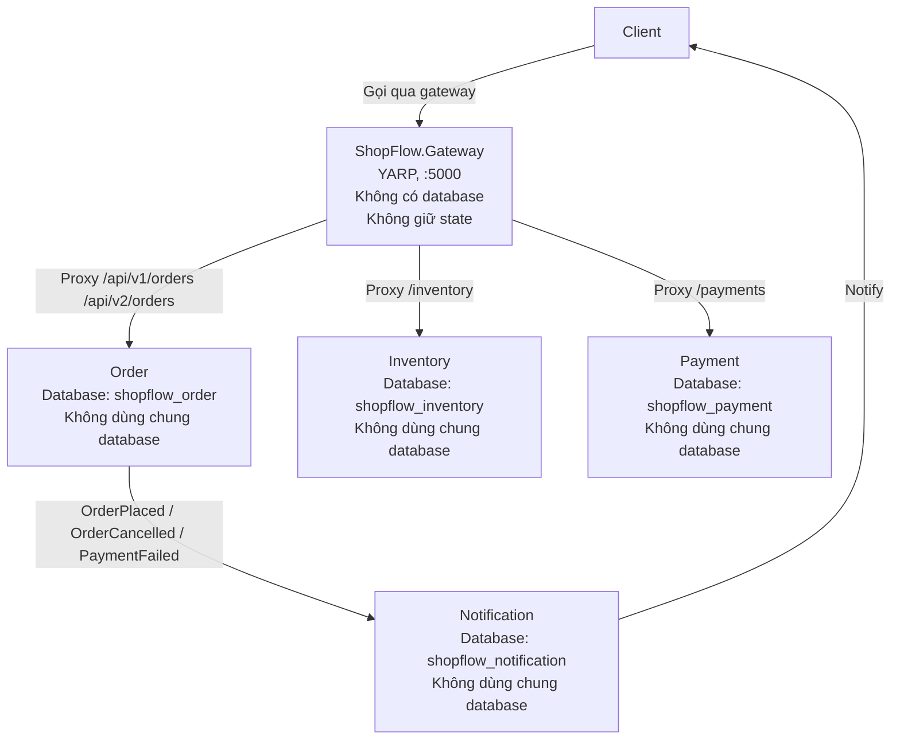

# Sơ đồ bounded context ShopFlow

Tài liệu này vẽ giới hạn dữ liệu, luồng nghiệp vụ và bảng thuật ngữ chuẩn của ShopFlow để giữ từng bounded context độc lập và không dùng chung database.

## 1. Mermaid bounded context diagram

## 2. Bảng sở hữu dữ liệu

| Bounded Context | Database dự kiến | Bảng/entity dự kiến | Ghi chú |
| --- | --- | --- | --- |
| Order | `shopflow_order` | `orders`, `order_items`, `order_events`, `outbox_messages`, `saga_state` | Dữ liệu đặt hàng và event liên quan do Order sở hữu. |
| Inventory | `shopflow_inventory` | `products`, `inventory_items`, `reservations`, `inventory_events` | Cất giữ số lượng, reserve/release và trạng thái kho. |
| Payment | `shopflow_payment` | `payments`, `payment_transactions`, `refunds`, `payment_events` | Chỉ lưu trạng thái thanh toán và compensation. |
| Notification | `shopflow_notification` | `notifications`, `notification_logs`, `message_dispatches`, `delivery_events` | Chỉ giữ nghĩa vụ gửi thông báo, không sở hữu order hay payment data. |

> Mỗi context có database riêng theo Day 38; không dùng chung database giữa các service để tránh coupling dữ liệu và dễ tách bounded context sau này.

## 3. Bảng Ubiquitous Language

| Thuật ngữ | Nghĩa | Context |
| --- | --- | --- |
| Place | Đặt đơn hàng mới | Order |
| Confirm | Xác nhận đơn đã được chốt để tiếp tục xử lý | Order |
| Cancel | Hủy đơn khi khách hoặc hệ thống không thể hoàn tất | Order |
| Fulfill | Hoàn tất đơn hàng khi sản phẩm được giao/đóng gói xong | Order |
| Reserve | Giữ hàng trong kho cho đơn đặt hàng | Inventory |
| Release | Bỏ khóa số lượng khỏi kho khi hủy hoặc rollback | Inventory |
| Charge | Trừ tiền theo phương thức thanh toán | Payment |
| Refund | Hoàn tiền khi có compensation | Payment |
| Notify | Gửi thông báo trạng thái cho khách hoặc hệ thống | Notification |
| Order | Đơn hàng chính của khách | Order |
| OrderItem | Một sản phẩm/chi tiết trong đơn | Order |
| Money | Số tiền thanh toán hoặc hoàn tiền | Payment |
| Address | Địa chỉ giao hàng hoặc thanh toán | Order |
| OrderStatus | Trạng thái hiện tại của đơn hàng | Order |
| IdempotencyKey | Khóa chống lặp request ở phía API/worker | Order/Payment |
| Outbox | Kênh lưu event chờ phát đi để đảm bảo tích hợp | Order/Notification |
| Saga | Chuỗi bước và compensation cho distributed transaction | Order/Inventory/Payment |
| Compensation | Hành động ngược để rollback khi bước sau thất bại | Payment/Inventory |